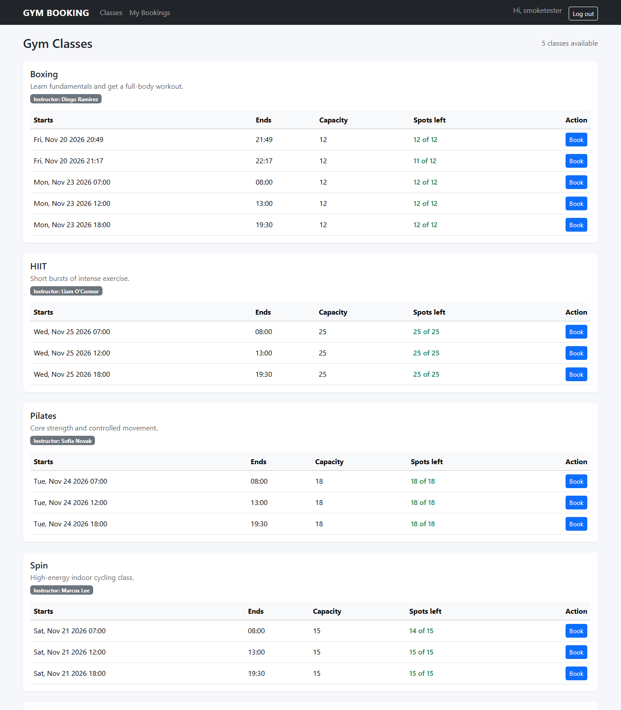
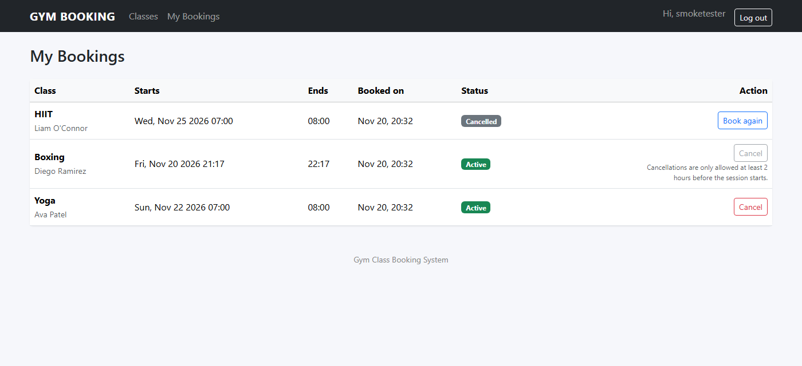
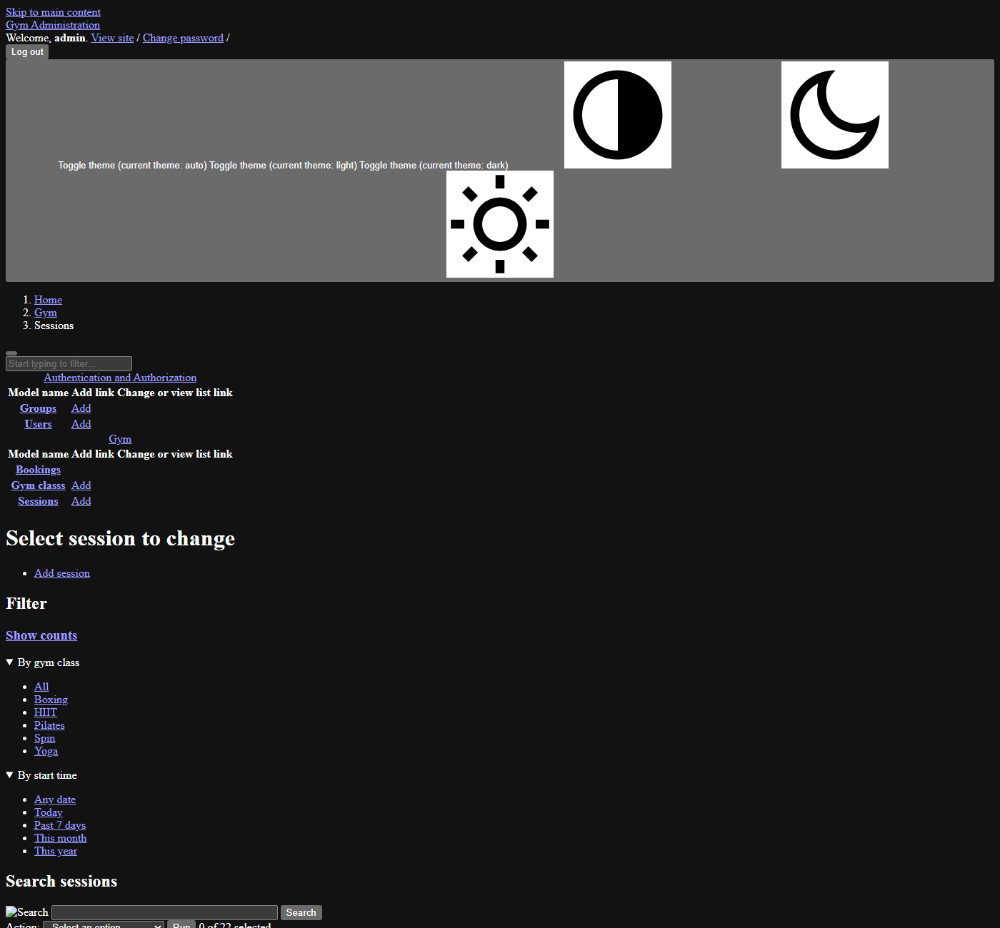

# Gym Class Booking System

A Django web application where gym members register, browse classes, and book
session spots — and administrators manage classes, schedules, and rosters.

Built with **Django 6.1 + SQLite**, Django's built-in authentication, and Bootstrap 5.

---

## Features

### Member
- Register, log in, log out
- Browse all gym classes and their upcoming sessions with **spots remaining**
- Book a session (one active booking per member per session)
- View **My Bookings**
- Cancel a booking (when allowed)
- **Re-book a session after cancelling** — a fresh booking row is created

### Administrator
- Full Django admin panel at `/admin/` to create and edit classes, sessions, and capacities
- View who is booked into each session (active and cancelled) — inline in the admin,
  or as a readable roster page at `/roster/<session_id>/`
- Staff accounts see a **View roster** button on the homepage instead of a booking button
- Bookings are **read-only** in the admin (cannot be created, edited, or deleted there)

---

## Business Rules

| # | Rule | Where it is enforced |
|---|------|----------------------|
| 1 | A session cannot be booked once it is at capacity | `Session.booking_error_for()` |
| 2 | A member cannot have two **active** bookings for the same session | `Session.booking_error_for()` **and** a partial DB `UniqueConstraint` on `(user, session)` where `status = 'active'` |
| 3 | Sessions that have started or are in the past cannot be booked | `Session.booking_error_for()` |
| 4 | Cancellation is allowed only at least **2 hours** before the start time | `Booking.cancellation_error`, `CANCEL_WINDOW_HOURS` |
| 5 | Members can only see and cancel **their own** bookings | `@login_required` + `get_object_or_404(..., user=request.user)` |
| 6 | Cancelled bookings free up their spot | `Session.booked_count` counts only `ACTIVE` bookings |
| 7 | Cancelling allows re-booking the session later | Partial unique index + `Booking.can_rebook` |
| 8 | Staff accounts cannot book sessions | `Session.booking_error_for()` checks `user.is_staff` |
| 9 | Admin cannot set capacity below current active bookings | `Session.clean()` |
| 10 | Session must have `end_time > start_time` and `capacity >= 1` | DB `CheckConstraint` + `Session.clean()` |

All booking and cancellation decisions live in **one place** —
`gym/models.py` — so the rules stay consistent across every page.
Views simply call `session.booking_error_for(user)` or
`booking.cancellation_error` and show the returned reason if it is not `None`.

---

## Tech Stack

- Python 3 + **Django 6.1.3**
- **SQLite** database (no setup required)
- Django's built-in auth (`django.contrib.auth`)
- Django Admin for administration
- HTML templates + **Bootstrap 5** (CDN)
- Django test framework (83 automated tests)

---

## Getting Started

### 1. Create a virtual environment

From the project root:

```bash
python -m venv venv
```

Activate it:

- **Windows:** `venv\Scripts\Activate`
- **macOS / Linux:** `source venv/bin/activate`

### 2. Install dependencies

```bash
pip install -r requirements.txt
```

### 3. Apply migrations

```bash
python manage.py migrate
```

### 4. Create an administrator account

```bash
python manage.py createsuperuser
```

Follow the prompts. Then log in at <http://127.0.0.1:8000/admin/>.

### 5. (Optional) Load sample classes and sessions

```bash
python seed_data.py
```

Creates 5 classes (Yoga, Spin, Boxing, Pilates, HIIT), 20 sessions, and one
session in the past so you can test the "already started" rule.

### 6. Run the development server

```bash
python manage.py runserver
```

Open <http://127.0.0.1:8000/>.

---

## Running the Tests

83 automated tests cover every business rule, view, authentication flow,
admin permission, database constraint, and a real concurrency race:

```bash
python manage.py test gym
```

Expected output ends with `OK`.

There is also an end-to-end smoke test that exercises the real database:

```bash
python smoke_test.py
```

Expected output ends with `25/25 checks passed`.

---

## Project Structure

```
gym-booking/
├── manage.py              # Django command-line tool
├── requirements.txt       # Django==6.1.3
├── gymproject/            # Project settings and root URLconf
│   ├── settings.py        # Installed apps, DB, auth redirects, message tags
│   ├── urls.py            # Root URL configuration
│   ├── wsgi.py / asgi.py  # WSGI / ASGI entry points
├── gym/                   # Main application
│   ├── models.py          # GymClass, Session, Booking + ALL business rules
│   ├── views.py           # home, register, book, my_bookings, cancel, roster
│   ├── urls.py            # App URL routes
│   ├── forms.py           # RegisterForm, LoginForm
│   ├── admin.py           # Admin registrations (read-only bookings)
│   ├── tests.py           # 83 tests
│   ├── migrations/        # 0001-0003 (constraints + index)
│   └── templates/gym/     # base, home, register, login, my_bookings, roster
├── seed_data.py           # Sample classes and sessions
├── smoke_test.py          # End-to-end checks against the real DB
├── screenshots.py         # Regenerates the screenshots below
└── screenshots/           # Demo screenshots
```

---

## Screenshots

| | |
|---|---|
|  |  |
| Homepage with classes, sessions and spots left | My Bookings: cancel button, blocked-cancellation reason, cancelled badge with **Book again** |
|  |  |
| Registration | Admin panel — sessions with capacity and spots left |

Additional screenshots: `04-admin-classes.png`, `06-admin-roster.png`
(admin view of the members booked into a session).

---

## Manual Test Scenarios

| Scenario | Expected result |
|---|---|
| Anonymous user clicks **Book** | Redirected to the login page; no booking created |
| Member books a future session | Booking created, spot count decreases |
| Member books the same session again | Rejected: "You have already booked this session." |
| Book a session that is already full | Rejected: "This session is fully booked." |
| Book a session that has started | Rejected: "This session has already started." |
| Cancel more than 2 hours before start | Cancellation succeeds; the spot is freed |
| Cancel, then click **Book again** on the cancelled booking | A new active booking is created; spot count decreases again |
| Re-book while another active booking already exists | Rejected: "You have already booked this session." |
| Cancel less than 2 hours before start | Rejected with the 2-hour notice |
| Cancel after the session started | Rejected |
| Member opens another member's booking URL | HTTP 404 |
| Member opens a roster URL | Redirected to the homepage |
| Admin opens a roster URL | Sees the list of booked members |
| Admin tries to reduce capacity below bookings | Rejected with validation error |
| Admin tries to delete a booking | HTTP 403 (read-only) |

---

## Security Notes

- `DEBUG = True` and the `SECRET_KEY` in `settings.py` are for **local development only**.
  Do not deploy this configuration to production.
- Passwords are hashed with Django's `PBKDF2` via `django.contrib.auth`.
- Registration uses `UserCreationForm` with Django's built-in password validators.
- Open-redirect protection: `next` parameters are validated with
  `url_has_allowed_host_and_scheme` before redirecting.
- CSRF protection is enabled on all forms via ``.
- SQLite uses `transaction_mode=IMMEDIATE` to prevent concurrent-write races
  from overselling capacity.

---

## Optional Extensions

Not implemented — left as future work:

- Filter classes by day or category
- Booking confirmation emails
- Waiting list for full sessions
- Django REST Framework API
